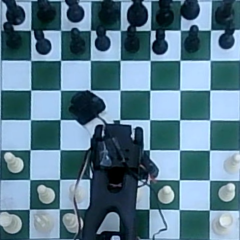
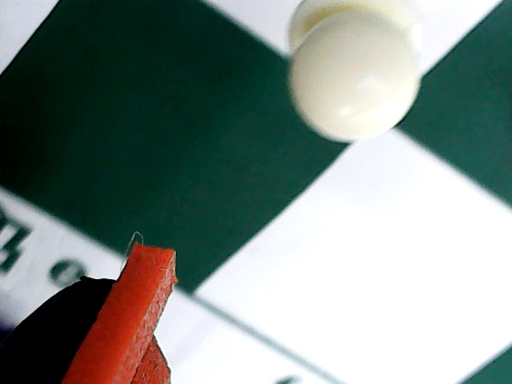

# Chess Playing Robot

A robotic arm that plays chess against you on a real board.

You move a piece and press Enter. An overhead webcam works out what you played, and an SO-101 arm picks the piece up and puts it on its
new square. Captures and castling included every move ;)

https://github.com/user-attachments/assets/e4a3fb24-c142-4289-a915-d2ebf2eec849

*A game against the arm. It plays White, from its side of the board.*

https://github.com/user-attachments/assets/3f030c3f-8454-415f-a4c4-e5c49e6064e5

*Close up of a few moves..*

It works well enough to play a full game, and badly enough that you might have to fix
a pawn by hand sometimes. Both halves of that sentence are documented below.

## How it works

The obvious way to build this is to train one policy that does the whole move.
Well I didn't. Almost everything the arm does is plain inverse kinematics, and a
learned policy handles only the few seconds where IK is not good enough: closing
the jaws around a piece, AKA picking a piece.

```
park ─▶ IK: hover above the piece ─▶ ACT policy: descend, grasp, lift
     ─▶ IK: glide to the target ─▶ IK: lower, release, back off ─▶ park
```

<p>
  
  
</p>

*Left: the overhead camera, with the arm hovering above e2. Right: the wrist camera
at the same moment. That second view is all the pick policy gets to look at.*

Why split it this way:

- **The arm is not accurate enough to grasp blind.** Its servos repeat to about
  5–13 mm, and a pawn's neck is about 10 mm wide. A policy watching the wrist
  camera can close that gap; IK cannot.
- **Everything else is easier to write than to teach.** Travelling above the
  pieces, setting one down, parking out of the camera's view: these are geometry,
  and geometry doesn't need 250 demonstrations.
- **The policy's job stays tiny.** It always starts from the same place (8 cm above
  a piece, jaws open, pointing down) and always does the same thing. That is why a
  few hundred demos are enough.

The chess side is deliberately dumb. The camera only tells empty, white or black
per square. The position is tracked in software from the starting position, and
your move is whichever legal move explains the squares that changed.

## Where it stands

Numbers from the last long game we logged with the current policy (13 picks by
the arm):

| | |
|---|---|
| Held on the first attempt | 9 |
| Held on a retry | 3 |
| Gave up, finished by hand | 1 |

One arm move takes about 20 seconds max, most of it careful travel.

What is still wrong:

- **Some squares are coin flips.** e2, d2 and e4 miss far more than the rest. The
  arm will not open with the e-pawn for exactly this reason.
- **Placing is open loop.** A placed piece lands 10–20 mm from the centre of its
  square. Usually fine, occasionally it confuses the camera.
- **Only ranks 1–5 are reachable (👉🏻👈🏻edge case they says)** (40 squares). If Stockfish's move needs a square
  further away, the arm plays its best reachable move instead, and if there is
  none you make the move for it.
- **The camera is fussy about light.** It compares each square against a photo of
  the empty board, so a lamp moving between that photo and the game causes
  misreads. Re-take the photo when that happens.

## What you need

- **SO-101 follower arm** (6× Feetech STS3215). Ours has red TPU V-groove pads
  glued to both jaws; the earlier bare-jaw round grasped less reliably.
- **SO-101 leader arm**, only for calibration and recording demos.
- **Two USB cameras**: one overhead on a rigid stand looking down at the board,
  one on the gripper.
- **A board with big squares.** Ours is the regular green and white mat with 49 mm squares and pieces
  that have a clear neck to grab (Best if you get same size pieces).
- **A Linux machine with a GPU** if you want to train. We used an RTX 4000 SFF Ada
  (20 GB); a 30k-step fine-tune took about two hours.
  

## Setup

```sh
git clone https://github.com/Dev-devadath/so101-chess && cd so101-chess
uv venv --python 3.12 .venv
uv pip install -r requirements.txt --override overrides.txt
brew install stockfish
```

The `--override` is not optional: lerobot wants numpy below 2.3, placo needs 2.3,
and the project runs on 2.3.

Then three things that are specific to your hardware:

1. **Serial ports.** Set the follower's in `chess/arm.py` (`PORT`) and the leader's
   in `chess/teach_squares.py` (`LEADER_PORT`). `scripts/chess_act_env.sh` has the
   same two.
2. **Servo calibration.** Calibrate both arms with lerobot's own tool under the ids
   `my_follower` and `my_leader`. The files in `calibration/` are ours and only
   fit our arms; they are in the repo so our datasets stay reproducible.
3. **Policy weights.** They live on the Hugging Face Hub, not in git:

   ```sh
   .venv/bin/hf download Dev-devadath/so101-chess-act-pick-wrist-v4 --local-dir policies/so101-chess-act-pick-wrist-v4
   ```

   It only works on a setup like ours (same jaw pads in the wrist view, same hover
   start), so expect to record and train your own; see
   [Train your own](#train-your-own-pick-policy).

Check that the basics work before going further:

```sh
.venv/bin/python chess/cam_view.py wrist     # live view + fps; also: top
.venv/bin/python chess/leader_check.py       # watch the leader for encoder jumps
.venv/bin/python tests/test_play.py          # game logic, no hardware needed
```

## Calibrating your setup

Our calibration files are in the repo, but they describe our table. For your own
board you redo all of it, once, in this order. Every script explains itself at the
top of the file, and the board must be **empty** for all of them.

| Step | Script | What it gives you |
|---|---|---|
| 1 | `chess/touch_calib.py` | Where the board is, by resting the gripper on 8+ squares by hand |
| 2 | `chess/fit_offsets.py <square_mm>` | Joint angle corrections that make the model match those touches |
| 3 | `chess/teach_squares.py` | The real position of every reachable square, nudged in with the leader |
| 4 | `chess/calibrate_board.py` | The board's corners in the overhead image |
| 5 | `chess/calibrate_nadir.py` | The point straight under the camera (tall pieces lean away from it) |
| 6 | `chess/calibrate_squares_cam.py` | A final per-square correction, measured by the camera |

Run each as `.venv/bin/python chess/<script>` from the repo root.

Then look before you trust it: `chess/reach_map.py` prints which squares solve
(no arm needed), and `chess/hover_squares.py` sends the arm to hover above each
one so you can see whether it is really centred.

Steps 4 and 5 need redoing whenever the camera stand gets bumped.
`chess/align_top_cam.py` helps you aim it back at the old view instead.

## Playing a game

Each session:

```sh
.venv/bin/python chess/board_state.py --ref    # photo of the EMPTY board, in the light you'll play in
```

Set up the pieces with White on the arm's side, park the arm, keep your hands
out of the picture, and:

```sh
.venv/bin/python chess/play.py --policy policies/so101-chess-act-pick-wrist-v4 --ensemble --skill 3
```

- `--policy` takes either a `pretrained_model` folder or a training output under
  `outputs/` (add `--ckpt 030000` for a specific checkpoint).
- `--ensemble` re-plans every frame. Our current policies need it.
- `--skill` is Stockfish's level, 0–20.
- `--no-arm` runs the game without the robot. You make the arm's moves by hand
  and the camera still reads the board. Good for testing the vision.

The arm is always White. Make your move, press Enter. If the camera can't work
out what you did, type the move instead (`e5`, `Nf6`, `e7e5`).

Captured pieces are dropped 1.5 squares past h1, off the board. Keep that spot
clear.

To try a single move without a game:

```sh
.venv/bin/python chess/run_pick.py d2 d4 --policy policies/so101-chess-act-pick-wrist-v4 --ensemble
```

Everything the arm does is logged to `chess/run_logs/`: a video of every pick
attempt, a video and a strip of stills for every placement, and a frame for every
camera misread. When something goes wrong, the answer is almost always in there.

## Train your own pick policy

### 1. Record

```sh
.venv/bin/python chess/record_pick.py --dataset so101_pick3 --back --jitter 6 e2 d2 c2 g1
```

The arm flies to the hover above each square by itself. You press Enter, take
over with the leader, go down, grasp, lift, and press Enter again. Each demo is
about five seconds of recording.

- `--back` puts the piece back on its own square afterwards, so you can record on
  a full board.
- `--jitter 6` starts each demo up to 6 mm off-centre, so you have to re-align
  over the piece. Without it the policy learns to descend without looking.
- `--resume` appends to an existing dataset.

`docs/RECORDING_PLAN.md` has the rules we recorded by. The short version: do
every demo the same way, and record the situations the game will actually
produce, not the easy ones.

### 2. Throw away the bad ones

Watch your demos back and delete the head grabs, the ones that never lifted, and
the ones where the fingertips dug into the mat. We dropped 24 of 271. Use
lerobot's `delete_episodes`; it writes a new dataset, so keep recording into the
raw one and rebuild the clean copy from it.

### 3. Train

`scripts/train_gpu.sh` copies the dataset to a GPU machine over ssh, trains
there, and pulls the result back:

```sh
GPU_HOST=you@gpu-box DATASET=so101_pick3_clean STEPS=100000 sh scripts/train_gpu.sh start
sh scripts/train_gpu.sh log      # follow along
sh scripts/train_gpu.sh pull     # checkpoints land in outputs/act_<dataset>
```

To continue from a policy you already have instead of starting over:

```sh
PRETRAINED=outputs/act_<old>/checkpoints/last/pretrained_model DATASET=<new set> STEPS=30000 sh scripts/train_gpu.sh start
```

The script expects `~/lerobot-arm` on the box with a `./venv` that has lerobot
and CUDA. Read its header before the first run; it is short.

## Datasets

All LeRobotDataset v3, 30 fps, 6-D state and action (5 joints + gripper, in
lerobot degrees). Every episode starts at the hover above a piece and ends with
the piece lifted.

| On the Hub | Local folder | Episodes | Frames | What it is |
|---|---|---|---|---|
| [`so101-chess-pick-raw`](https://huggingface.co/datasets/Dev-devadath/so101-chess-pick-raw) | `so101_pick3` | 271 | 39,593 | The raw recording, bad demos included. Record new demos into this one. |
| [`so101-chess-pick-wrist-v4`](https://huggingface.co/datasets/Dev-devadath/so101-chess-pick-wrist-v4) | `so101_pick3_wrist_v4` | 247 | 35,982 | The above minus 24 bad demos, wrist camera only. Trains the current policy. |
| [`so101-chess-pick-v1`](https://huggingface.co/datasets/Dev-devadath/so101-chess-pick-v1) | `so101_pick3_clean` | 112 | 13,526 | The first round, on a near-empty board, both cameras. Trained `act_pick_v1`. |
| [`so101-chess-pick-v0`](https://huggingface.co/datasets/Dev-devadath/so101-chess-pick-v0) | `so101_pick2` | 96 | 14,166 | Older still: bare jaws wrapped in string, inconsistent demos. Don't mix it with the others. |

Each dataset's page lists its known problems. The local folder names are the ones
the scripts and commands in this README use. Load one with the pyav backend,
since torchcodec wants a system FFmpeg:

```python
from lerobot.datasets import LeRobotDataset
ds = LeRobotDataset("Dev-devadath/so101-chess-pick-wrist-v4", video_backend="pyav")
```

And the policies:

| Policy | Trained on | Status |
|---|---|---|
| [`so101-chess-act-pick-wrist-v4`](https://huggingface.co/Dev-devadath/so101-chess-act-pick-wrist-v4) | `so101-chess-pick-wrist-v4` | Current. Run with `--ensemble`. |
| [`so101-chess-act-pick-wrist-v3`](https://huggingface.co/Dev-devadath/so101-chess-act-pick-wrist-v3) | first 205 episodes of the same | Weak mid-board. Kept as v4's baseline. |
| [`so101-chess-act-pick-v1`](https://huggingface.co/Dev-devadath/so101-chess-act-pick-v1) | `so101-chess-pick-v1` | Wrist + overhead. Fine on an empty board, fails in a real game. |

## What we learned the hard way

- **Record what the game looks like.** Our first 112 demos were on a nearly empty
  board. The policy was 10 for 10 in tests, then in a real game the black pieces
  at the far end shifted its grasps half a square: it had been aiming partly from
  the overhead camera's view of an empty board. We dropped that camera and kept
  adding demos from real positions: the starting position, then the full back
  ranks, then the middle of the board. Each round fixed the squares it covered
  and nothing else.
- **The policy memorises more than it looks.** Send it to e2 five times and it
  goes to almost exactly the same spot five times, wherever the pawn is. More
  data widened the set of squares it knows. It did not teach it to aim.
- **Our attempt to fix that failed.** We retrained with joint angles measured
  relative to the start of each pick, hoping to force it to use the camera. It
  got worse: one grasp in five, closing the jaws in mid-air.
  `scripts/make_relative.py` is still here if you want to try your luck.
- **Retry from somewhere else.** Retrying a miss from the same hover repeats the
  same miss. Shifting the start by a few millimetres lets many retries succeed.
- **The gripper has a fixed jaw, and it matters.** Only one jaw moves. After
  opening, the other is still touching the piece, and lifting straight up drags
  the piece along. The arm now slides sideways to centre the open jaws first.
- **Log everything.** Nearly every fix in this repo came from watching a saved
  video of the failure, not from reasoning about what probably happened.

## Repository layout

```
chess/
  play.py                  the game loop
  run_pick.py              one move: hover, policy pick, carry, place (the Mover class)
  record_pick.py           record pick demos with the leader
  arm.py                   follower connection, FK/IK (placo + URDF), moves, park
  reach_map.py             jaw and tool geometry, IK with the jaws pointing down
  hover_squares.py         the hover pose above each square; the drop zone
  board.py                 overhead image -> top-down 8x8 view
  board_state.py           empty / white / black per square
  cameras.py               find cameras by name (macOS shuffles the indices)

  touch_calib.py  fit_offsets.py  teach_squares.py          arm calibration
  calibrate_board.py  calibrate_nadir.py  align_top_cam.py  camera calibration
  calibrate_squares_cam.py                                  per-square correction

  place_check.py           measure where a placed piece landed
  gripper_check.py         gripper reading when closed on a piece
  leader_check.py  leader_gripper_range.py                  leader arm health
  cam_view.py  read_pose.py                                 small debugging tools

  *.json  board_ref.png  top_ref_calib.jpg                  our calibration data
  so101_urdf/              the SO-101 URDF and meshes
scripts/
  train_gpu.sh             train on a remote GPU box, pull the checkpoints
  make_relative.py         convert a dataset to relative joint angles
  chess_act_env.sh         ports and defaults shared by the scripts
policies/act_pick_v1/      first pick policy (config and notes; weights not in git)
calibration/               our lerobot servo calibration
docs/                      DESIGN.md (the original plan), RECORDING_PLAN.md
tests/                     offline tests for the board and game logic
```

Run every script from the repo root.

## Credits

Built on [LeRobot](https://github.com/huggingface/lerobot) for arm control,
recording and training, the [SO-101](https://github.com/TheRobotStudio/SO-ARM100)
arm from TheRobotStudio, the [ACT](https://tonyzhaozh.github.io/aloha/) policy,
[placo](https://github.com/Rhoban/placo) for kinematics,
[python-chess](https://github.com/niklasf/python-chess) and
[Stockfish](https://stockfishchess.org).
